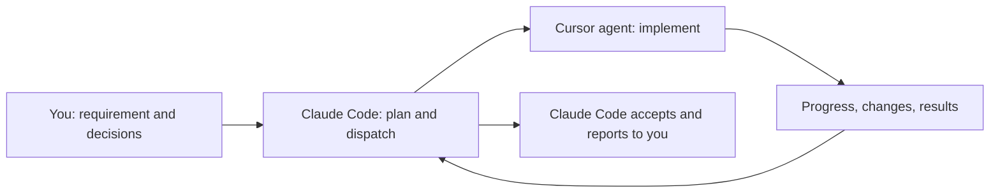

# AgentForge

**Let Claude Code direct Cursor agents.**

[简体中文](README.md) | **English**

AgentForge is a Claude Code plugin that makes Claude the commander and reviewer and Cursor the hands-on worker. Claude plans, splits, follows up on, and accepts the work while a background Cursor agent edits files and runs commands. This saves Claude tokens, lowers cost, and cuts the friction of switching between tools. The AgentForge board in Claude Code sets the dispatch switch, executor, model, thinking effort, and new-session permission, manages SDD task documents, and checks for plugin updates.

State the requirement in Claude Code, let a Cursor agent do the hands-on work, and stay in the same session to check progress, ask follow-up questions, and accept the result. Auto-dispatch is off by default; while it is off, Claude Code works as usual.

[Roles](#roles) · [Quick start](#quick-start) · [First dispatch](#first-dispatch) · [Daily use](#daily-use) · [FAQ](#faq) · [Scope](#scope) · [Advanced guide](docs/advanced.en.md)

## What it does

For people who already use Claude Code and Cursor together and want to stop copying prompts and results between them.

| You want to | How it works |
|---|---|
| Hand a concrete coding task to Cursor | Give Claude Code the goal, directory, and acceptance criteria; it dispatches the task |
| Decide when to delegate | Toggle **Auto-dispatch** on the board and pick the executor, model, and effort |
| Check progress or ask for changes | Ask Claude Code for the status, or send more instructions to the same Cursor agent |
| Make sure the result works | Claude Code reads the changes and runs the verification command; failures go back for rework |



## Roles

Claude makes the key decisions in Claude Code; the Cursor agent delivers:

- **Clear boundaries**: turn the requirement into a goal, the files that may change, and behavior that must stay.
- **An easy brief**: implementation steps, edge cases, and acceptance criteria.
- **Coordinated changes**: for several tasks, settle interfaces and order first, and keep parallel tasks off the same files.
- **Review**: check the changes and verification output, then ask for rework where needed.

The default executor is Cursor (agents run locally through `@cursor/sdk`) with any model from Cursor's catalog. Other executors can be added as worker plugins; see the [advanced guide](docs/advanced.en.md#worker-plugins).

## Quick start

### 1. Requirements

Works on macOS and Windows (Linux as macOS). The commands are the same in a macOS terminal and Windows PowerShell; only environment variables are set differently, as shown below.

- **Node.js 22.13+** and npm.
- **Claude Code CLI** (`claude` on `PATH`, or pass `--claude` at install). The board uses Claude Code's function hooks (early access): start Claude Code with `CLAUDE_CODE_ENABLE_FUNCTION_HOOKS=1`. Without them the MCP tools, the prompt hook, and the command-line settings still work.
- **A Cursor account**: browser sign-in, or a `CURSOR_API_KEY`.

```bash
git clone https://github.com/bard1124/AgentForge.git
cd AgentForge
npm install && npm run build
```

Keep the checkout: the plugin runs from its `dist/`. Below, `agentforge` means `node dist/cli.js`; after `npm link` the `agentforge` command works directly.

### 2. Connect Cursor

```bash
node dist/cli.js login        # browser sign-in to Cursor; stores an SDK API key
node dist/cli.js whoami       # check the sign-in
node dist/cli.js models       # list models and their parameters
```

Instead of signing in you can set the `CURSOR_API_KEY` environment variable or put it in `~/.claudeforge/.env` (`%USERPROFILE%\.claudeforge\.env` on Windows; see [`.env.example`](.env.example)).

### 3. Install the plugin and board

```bash
node dist/cli.js install
```

This writes a local marketplace and installs the `agentforge@agentforge-local` plugin: MCP tools, the `UserPromptSubmit` hook, the board pane, and the `/forge` command. Options: `--scope user|project|local`, `--worker <name>` (the board's initial executor), `--claude <path>`; the choice is remembered for uninstall and updates.

Then:

1. Restart Claude Code with function hooks on: `CLAUDE_CODE_ENABLE_FUNCTION_HOOKS=1 claude` on macOS, `$env:CLAUDE_CODE_ENABLE_FUNCTION_HOOKS=1; claude` in Windows PowerShell (or run `setx CLAUDE_CODE_ENABLE_FUNCTION_HOOKS 1` once and open a new terminal).
2. Run `/mcp` and check that `plugin:agentforge:agentforge` is connected.
3. Run `/forge-board`, pick the executor and a model (or follow the executor default), and an effort for a fixed model.
4. Turn on **Auto-dispatch**. It applies from the next message, with no restart.

How the board appears is the plugin's one option, under Settings → Plugins → AgentForge → **Board**: `button` (default) shows a one-line status with an **Open board** button above the prompt while the board is closed; `auto` opens it when a session starts; `command` opens it only with `/forge-board`. Dispatch settings live on the board.

## First dispatch

Try a small task whose result is easy to check. In a new Claude Code session with auto-dispatch on, send:

```text
Create hello.js in ~/agentforge-demo that prints Hello, World!.
Change only hello.js. Hand it to Cursor, run it to verify, and tell me the result.
```

Claude Code saves a task document (with SDD on) and dispatches; the Cursor agent creates and runs the file; Claude Code then reads the changes, runs the verification, and reports. Check it yourself with `node ~/agentforge-demo/hello.js`.

With auto-dispatch off, `/forge <task>` or "hand this to Cursor" still dispatches. **A successful dispatch only means the agent has started; whether the work is done shows in the changes, the verification output, and the acceptance.**

## Daily use

| Switch | What happens |
|---|---|
| On | Claude Code plans, dispatches, and accepts coding, fixing, and testing tasks; it answers questions and plans by itself |
| Off (default) | Claude Code works as usual and does not dispatch on its own |
| Off, but you ask | "Hand this to Cursor" or `/forge` still dispatches |

Settings apply to every session sharing the data directory (`~/.claudeforge`). New tasks use the current settings; existing tasks and follow-ups keep their agent's. Without the board: `agentforge on | off`, `agentforge config show`, `agentforge config set key=value ...`.

Ask in the same session: "How's the Cursor task going?", "Ask it why it changed the DTO", "Show me the diff and accept it if tests pass", "Cancel that task". Turning auto-dispatch off or closing the board or the session never cancels running work; ask for a cancel.

- **SDD task documents**: with SDD on (default), Claude Code saves each task's goal, scope, plan, and acceptance as a `task.md` (`~/.claudeforge/sdd` by default) before dispatching and hands the path to the agent. Saves are checked against the revision read, so a concurrent edit is refused instead of overwritten.
- **Plugin updates**: the board's **Plugin update** section, or `agentforge update status|check|apply`, fast-forwards this checkout from `origin`, rebuilds, and reinstalls, only when the checkout is clean and no task is running.
- **Shared backend**: all sessions and the board share one `agentforge-backend` (127.0.0.1 only, per-home token); tasks keep running after the dispatching session closes. `agentforge backend status` shows it.
- **Monitor**: `agentforge monitor` (live terminal view) or `agentforge monitor --web` (read-only page on `http://127.0.0.1:18862`).

## FAQ

### The board does not appear

Start Claude Code with `CLAUDE_CODE_ENABLE_FUNCTION_HOOKS=1` and run `/forge-board`. If it still does not appear, run `/reload-plugins` or restart, and check that `claude plugin list` shows `agentforge@agentforge-local` enabled.

### Auto-dispatch is on, but nothing is dispatched

Check the hook state on the board: `Pending` means the next message picks it up; a `disableAllHooks` warning means hooks are off in Claude Code's settings. The switch is advice to Claude Code, not a lock: it may still answer questions or make trivial edits itself.

### The executor is offline or lists no models

Run `agentforge whoami`, then `agentforge login` or set `CURSOR_API_KEY` if needed, and `agentforge backend status` to check the backend.

### A task did not finish

Check its status in Claude Code; `forge_status` shows recent steps and how long the agent has been silent. `uncertain` means the turn was cut off (for example by a backend restart): check the files first, then look it up by its original `order_id` or resume it with `forge_followup`. **Do not re-dispatch the same change under a new order_id.** `blocked` means a turn or time budget ran out and needs your go-ahead.

### Upgrading from ClaudeForge

AgentForge was called ClaudeForge before 0.5. Run `node dist/cli.js install` once in the checkout: it uninstalls the old `claudeforge@claudeforge-local` plugin and marketplace and installs `agentforge@agentforge-local`; the MCP tools become `mcp__plugin_agentforge_agentforge__*`. The `claudeforge` command stays as an alias, and `~/.claudeforge` and the `CLAUDEFORGE_*` variables are unchanged. The repository moved to `bard1124/AgentForge`; GitHub redirects the old URL and updates keep working from an old clone, or run `git remote set-url origin git@github.com:bard1124/AgentForge.git`.

## Scope

Cursor is the built-in executor (local `@cursor/sdk`); worker plugins add others, and workers can get MCP servers. Supported: working directory, model and parameters, follow-ups on the same agent, verification with automatic rework, turn and time budgets, token usage, and listing, archiving, and restoring agent conversations.

The Cursor agent runs with your user's permissions; trust it as you would Cursor's agent mode. Parallel tasks in the same directory can overwrite each other's edits; dispatch warns but does not prevent it. AgentForge does not commit or merge code and does not schedule across machines.

## Learn more

- [Advanced guide](docs/advanced.en.md): MCP tools, task states, budgets, models, worker plugins and MCP, environment variables, backend, monitor, running without Claude Code, development.
- [Examples](examples/README.md): a runnable demo, a worker plugin, and an MCP config.
