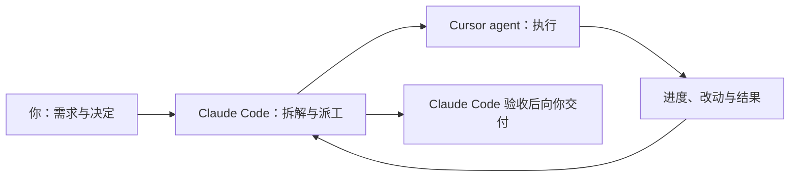

# AgentForge

**让 Claude Code 指挥 Cursor agent 干活。**

**简体中文** | [English](README.en.md)

Claude Code 多 Agent 派工插件：Claude 做「指挥官 + 验收官」，负责规划、拆解、跟进与验收；Cursor agent 做「执行工」，在后台改代码、跑命令。这样能节省 Claude 的 token、降低成本，也减少在工具之间来回切换。Claude Code 里的 AgentForge 看板可设置派工开关、执行端、模型、思考强度与新会话权限，管理 SDD 任务文档，并提供插件更新入口。

在 Claude Code 里提需求，把具体工作交给后台的 Cursor agent，再回到同一个会话查看进度、继续追问、验收产物。派工开关默认关闭；关闭时继续按原来的方式使用 Claude Code。

[分工与选型](#分工与选型) · [安装与接入](#安装与接入) · [第一次派工](#第一次派工) · [日常使用](#日常使用) · [常见问题](#常见问题) · [支持范围](#支持范围) · [进阶手册](docs/advanced.md)

## 它帮你完成什么

当你已经同时在用 Claude Code 和 Cursor 时，AgentForge 把需求下发、进度跟踪和结果回传接起来，不再在两个工具之间复制粘贴。

| 你要做的事 | 使用方式 |
|---|---|
| 把明确的编程任务交给 Cursor | 在 Claude Code 说明目标、目录和验收条件，由它派发任务 |
| 随时决定是否派工 | 在看板切换「自动派工」，选择执行端、模型和思考强度 |
| 知道任务进度或接着修改 | 在 Claude Code 查询状态，或继续提要求，沿用同一个 Cursor agent 会话 |
| 检查交付是否可用 | Claude Code 读取结果和改动，运行验证命令，不通过时自动打回返工 |



## 分工与选型

Claude 在 Claude Code 中做关键决策，Cursor agent 负责高频交付：

- **明确边界**：把需求转成目标、允许修改的范围和必须保留的行为。
- **降低执行难度**：给出实现步骤、异常场景和验收条件。
- **协调修改**：多个任务时先定接口与修改顺序，避免在同一目录并行改同一批文件。
- **检查交付**：核对改动和验证结果，再安排必要的返工。

执行端默认是 Cursor（通过 `@cursor/sdk` 在本机运行 agent），模型可选 Cursor 目录中的任意模型；也可以用 Worker 插件接入其他执行端，见[进阶手册](docs/advanced.md#worker-插件)。

## 安装与接入

### 1. 准备环境

支持 macOS 和 Windows（Linux 同 macOS）。命令在 macOS 的终端、Windows 的 PowerShell 中都一样；只有环境变量的写法不同，下文分别给出。开始前需要：

- **Node.js 22.13+** 和 npm。
- **Claude Code CLI**（`claude` 在 `PATH` 中，或安装时用 `--claude` 指定路径）。看板依赖 Claude Code 的 function hooks（早期功能），启动时需设置 `CLAUDE_CODE_ENABLE_FUNCTION_HOOKS=1`；不开启时 MCP 工具、提示 Hook 和命令行设置仍可用。
- **Cursor 账号**：浏览器登录，或准备好 `CURSOR_API_KEY`。

```bash
git clone https://github.com/bard1124/AgentForge.git
cd AgentForge
npm install && npm run build
```

安装完成后请保留仓库目录，插件运行时会从这里的 `dist/` 启动。下文的 `agentforge` 命令等同于 `node dist/cli.js`；运行 `npm link` 后可直接使用 `agentforge`。

### 2. 连接 Cursor

```bash
node dist/cli.js login        # 浏览器登录 Cursor，保存 SDK API key
node dist/cli.js whoami       # 确认登录状态
node dist/cli.js models       # 列出可用模型及参数
```

也可以不登录，直接设置 `CURSOR_API_KEY` 环境变量，或写入 `~/.agentforge/.env`（Windows 为 `%USERPROFILE%\.agentforge\.env`，参考 [`.env.example`](.env.example)）。

### 3. 安装插件与看板

```bash
node dist/cli.js install
```

这一步会生成本地 marketplace 并安装 `agentforge@agentforge-local` 插件，包含 MCP 工具、`UserPromptSubmit` Hook、看板面板和 `/forge` 命令。可选参数：`--scope user|project|local`、`--worker <name>`（看板初始执行端）、`--claude <path>`；选择会被记住，卸载和更新时沿用。

安装后：

1. 开启 function hooks 并重启 Claude Code：macOS 用 `CLAUDE_CODE_ENABLE_FUNCTION_HOOKS=1 claude`；Windows PowerShell 用 `$env:CLAUDE_CODE_ENABLE_FUNCTION_HOOKS=1; claude`（长期生效可运行一次 `setx CLAUDE_CODE_ENABLE_FUNCTION_HOOKS 1` 后新开终端）。
2. 运行 `/mcp`，确认 `plugin:agentforge:agentforge` 已连接。
3. 运行 `/forge-board` 打开看板，选择执行端和模型，或跟随执行端默认；选了固定模型后可设置思考强度。
4. 打开 **自动派工**。设置从下一条消息生效，无需重启。

看板的出现方式是插件唯一的选项，在 Claude Code 的 Settings → Plugins → AgentForge → **Board** 中设置：`button`（默认）在看板关闭时于输入框上方显示一行状态和「Open board」按钮；`auto` 在会话开始时自动打开；`command` 只通过 `/forge-board` 打开。派工相关设置都在看板里改。

除「Dispatch」外，看板各区都可点标题前的 ▾ / ▸ 折叠或展开，折叠后标题旁显示一行摘要；折叠状态保存在 `~/.agentforge/delegation.json`，所有会话共用。

## 第一次派工

先用一个能直接核对结果的小任务走通流程。在已开启自动派工的 Claude Code 新会话中发送：

```text
在 ~/agentforge-demo 中创建 hello.js，运行后输出 Hello, World!。
只修改 hello.js。交给 Cursor 实现，完成后实际运行验证，告诉我结果。
```

Claude Code 会保存任务文档（SDD 开启时）、派发任务；Cursor agent 在后台创建文件并运行；最后 Claude Code 读取改动、运行验证命令并向你报告。也可以自己验证：

```bash
node ~/agentforge-demo/hello.js
```

没开自动派工时，用 `/forge <任务描述>` 或直接说「交给 Cursor 做」同样会派工。**派发成功只表示 agent 已开始工作；是否完成要看改动、验证输出和验收结果。** 任务没有完成时，按[任务没有完成时怎么查](#任务没有完成时怎么查)检查。

## 日常使用

### 自己决定什么时候派工

| 开关状态 | 后续行为 |
|---|---|
| 开启 | Claude Code 规划、拆解、派工并验收编码、修复和测试任务；问答、讨论与规划自己处理 |
| 关闭（默认） | Claude Code 按原来的方式工作，不主动派工 |
| 关闭，但你明确要求 | 「交给 Cursor」或 `/forge` 仍会派工 |

开关、执行端、模型、思考强度和新会话权限对**共用同一数据目录（`~/.agentforge`）的所有会话**生效。新任务使用当前设置，已有任务和追问沿用原 agent 的配置；切换执行端会清空为上一个执行端选的模型、强度和权限。

「新会话权限」（Cursor：sandbox、auto-review 或两者）只在为任务新建 agent 时应用一次；执行端无法应用所选权限时会直接拒绝派工，不会用默认权限静默执行。

不用看板时，同样的设置可以在终端修改：

```bash
agentforge on | off
agentforge config show
agentforge config set executor=cursor model=gpt-5.5 effort=high permission=sandbox
```

### 查看、补充或停止任务

| 目的 | 示例消息 |
|---|---|
| 查进度 | 「Cursor 那个任务进行得怎么样了？」 |
| 补充要求 | 「问它为什么改了 DTO，再补一个边界条件测试。」 |
| 验收 | 「给我看 diff，测试通过就验收。」 |
| 停止 | 「取消刚才的任务，确认 agent 已经停下。」 |

关闭自动派工、关闭看板或关闭 Claude Code 会话，都不会取消已经在执行的任务；需要停止时明确要求取消，或在看板的任务卡片上操作：运行中的任务可 **Pause**（暂停，保留 agent，状态为 `paused`）或 **Cancel**，暂停的任务可 **Resume** 在同一个 agent 上继续，已结束的任务可 **Delete**，**Clear finished** 一次删除所有已结束的任务（删除需确认）。卡片每次显示 8 个任务，用 ▲ / ▼ 翻页。看板隐藏时暂停刷新，任务在后台继续执行。

### 轻量 SDD 任务文档

SDD 开启时，Claude Code 在方案确定后、派工前，先用 `sdd_task` 把每个任务的**目标、范围、计划和验收条件**保存为一份 `task.md`，再把文档路径交给 Cursor agent。方案因此不随对话丢失，也可以手动编辑。普通问答和讨论不创建文档。

SDD 有独立开关，在看板中设置，默认开启；工作区默认 `~/.agentforge/sdd`。每次保存都带读取时的版本号，文档在此期间被改过时会拒绝保存并提示冲突，看板会保留你的草稿。关闭 SDD 后文档仍可读，写入一律拒绝，自动派工照常可用。

### 估算节省的 token

看板的「Token savings (estimate)」区按今天、最近 7 天和全部显示节省比例：(委派 − Claude) / 委派。委派是执行端各任务轮次的 token 合计；Claude 是 Claude 与 AgentForge 每次 MCP 工具调用的参数和返回文本的估算 token（记在 `~/.agentforge/claude-traffic.jsonl`）。这只是估算：它假设 Claude 自己做会花掉与执行端差不多的 token，也不计 Claude 之后重读工具结果的消耗；比例可能为负。

### 检查并安装插件更新

看板底部折叠的「Plugin update」区，或 `agentforge update status|check|apply`，可以从 `origin` 更新本仓库。打开看板时每天最多自动检查一次；「Check for updates」立即检查。

只有已跟踪文件干净、当前分支可快进且没有运行中的任务时才会更新：快进后执行 `npm ci`、`npm run build` 并重装插件。不会 stash、reset、强推，也不会动 SDD 文档等未跟踪文件。更新后按看板提示重启后台，并在 Claude Code 中运行 `/reload-plugins`。

### 多个会话一起使用

同一数据目录下，所有 Claude Code 会话和看板共用一个 **`agentforge-backend`** 后台进程（只监听 127.0.0.1，带本机私有 token）。打开多个会话不会各自启动一套 worker；派工的会话关闭后，任务仍在后台继续。用 `agentforge backend status` 查看 PID、端口、版本和运行中的任务。

### 监控任务

```bash
agentforge monitor          # 终端实时视图：↑↓ 选择，f 过滤，r 刷新，q 退出
agentforge monitor --web    # 只读网页 http://127.0.0.1:18862
```

监控只读取任务文件和设置，不会启动后台或修改任务。

## 常见问题

### 看板没有出现

确认启动 Claude Code 时设置了 `CLAUDE_CODE_ENABLE_FUNCTION_HOOKS=1`，再运行 `/forge-board`。仍没有时，运行 `/reload-plugins` 或重启 Claude Code，并确认 `claude plugin list` 中 `agentforge@agentforge-local` 为 enabled。

### 打开了自动派工，但 Claude Code 没有派工

看看板上的 Hook 状态：`Pending` 表示下一条消息才会生效；如果提示 `disableAllHooks`，需要在 Claude Code 设置中允许 Hook。开关只是给 Claude Code 的建议，不是强制锁：开启时它仍可能自己处理问答或很小的改动。

### 执行端显示离线或模型列表为空

运行 `agentforge whoami` 检查 Cursor 登录状态，必要时重新 `agentforge login` 或设置 `CURSOR_API_KEY`。再运行 `agentforge backend status` 确认后台在线；后台在线与执行端在线是两件事。

### 任务没有完成时怎么查

在 Claude Code 中查看原任务状态。`forge_status` 会给出最近步骤和 agent 已静默的秒数；长时间没有输出时可以取消后用 `forge_followup` 在同一个 agent 上重试。

若状态为 `uncertain`，表示执行中途被打断（例如后台被重启）：先检查实际改动，再用原 `order_id` 查询或用 `forge_followup` 续跑，**不要用新的 order_id 重新派发同一份改动**。`blocked` 表示轮次或时间预算用完，需要你确认后再继续。

### 找不到 `claude` 命令

`install` 和 `uninstall` 都支持 `--claude /绝对路径/claude`，选择会被记住。

## 支持范围

当前内置 **Cursor** 执行端（`@cursor/sdk` 本机运行），可通过 Worker 插件扩展其他执行端，并可为 worker 挂载 MCP 服务器。支持指定工作目录、模型与参数、同一 agent 追问、验证与自动返工、轮次和时间预算、token 用量统计，以及 agent 会话的列出、归档与恢复。

Cursor agent 以你的用户权限运行，请像对待 Cursor 的 agent 模式一样信任它；同一目录下并行的任务可能互相覆盖改动，派工时会提示但不会阻止。本工程不自动提交或合并代码，也不提供远程多机调度。

## 继续阅读

- [进阶手册](docs/advanced.md)：MCP 工具、任务状态、预算、模型、Worker 插件与 MCP、环境变量、后台、监控、不经 Claude Code 直接运行、开发与验证。
- [示例](examples/README.md)：可运行的演示、Worker 插件和 MCP 配置。
